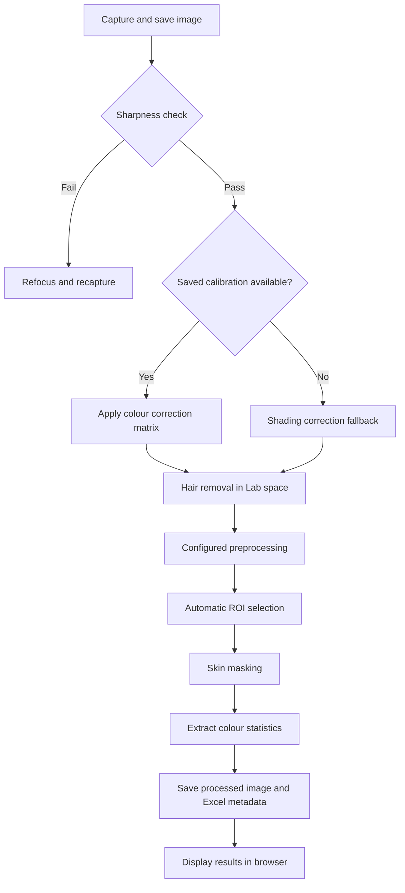

<div align="center">

# 🩺 Jaundice Pi
### Skin Imaging & Colour Analysis

**A final-year research project combining MATLAB image processing with a Python camera application for Raspberry Pi.**


**Capture → Calibrate → Clean → Segment → Measure**

</div>

---

## 📋 Contents

- [Overview](#overview)
- [Repository layout](#repository-layout)
- [Implemented features](#implemented-features)
- [Processing pipeline](#processing-pipeline)
- [Python setup](#python-setup)
- [Camera calibration](#camera-calibration)
- [Web interface](#web-interface)
- [MATLAB prototype](#matlab-prototype)
- [Statistical analysis](#statistical-analysis)
- [Configuration and outputs](#configuration-and-outputs)
- [Limitations](#limitations)
- [Troubleshooting](#troubleshooting)

<a id="overview"></a>
## 🔬 Overview

This project explores skin image processing and colour measurement in the context of neonatal jaundice research. A USB dermatoscope captures close-up images, and an image-processing pipeline extracts **CIE L\*a\*b\*** and RGB statistics from selected skin pixels.

The repository includes two implementations:

| Folder | Implementation | Purpose |
| :--- | :--- | :--- |
| [`Prototype/`](Prototype/) | MATLAB | Algorithm development, five-position capture and colour-consistency comparisons |
| [`Jaundice_Pi/`](Jaundice_Pi/) | Python + Flask | Camera capture, image processing, browser-based results and Raspberry Pi deployment scripts |

> 🧪 **Research scope:** The implemented outputs are colour measurements, processed images and quality metrics. This repository does not establish a validated bilirubin estimator or clinical diagnostic accuracy. It is an academic prototype, not a certified medical device.

<a id="repository-layout"></a>
## 📂 Repository Layout

```text
Image_cleaning-Colour-Analysis/
├── README.md
├── Prototype/                      # MATLAB implementation
│   ├── config/
│   │   ├── params.m                # Processing parameters
│   │   └── paths.m                 # Data/output paths
│   ├── src/
│   │   ├── main.m                  # Capture and analysis workflow
│   │   ├── calibrateCamera.m
│   │   ├── ColourCalib/            # Colour-card sampling and CCM
│   │   ├── hair_removal/
│   │   ├── preprocessing/
│   │   └── utilities/              # Capture, ROI, statistics, Excel
│   └── FOV.m
└── Jaundice_Pi/                     # Python/Raspberry Pi implementation
    ├── app.py                      # Flask routes and server
    ├── main.py                     # Application entry point
    ├── requirements.txt
    ├── statistical_analysis.py
    ├── config/settings.py
    ├── src/
    │   ├── colour_calib/
    │   ├── hair_removal/
    │   ├── mask_skin/
    │   ├── pipeline/               # Capture and debug pipelines
    │   ├── preprocessing/
    │   └── utilities/
    ├── templates/                  # Capture, gallery, results, calibration, debug
    ├── static/                     # CSS and JavaScript
    └── scripts/                    # Setup, start and systemd template
```

Runtime data directories are created or populated during use; a fitted calibration matrix and capture results are not supplied as a ready-to-use dataset.

<a id="implemented-features"></a>
## ✨ Implemented Features

| Area | Features |
| :--- | :--- |
| 📷 **Acquisition** | USB camera capture; Python live MJPEG preview; MATLAB five-position capture |
| 🎨 **Colour processing** | DGK 18-patch calibration, colour correction matrix and shading correction fallback |
| 🧹 **Image cleaning** | Sharpness check, morphological hair detection, inpainting and configurable preprocessing |
| 🎯 **Skin selection** | Automatic region-of-interest search and skin masking |
| 📊 **Measurements** | Mean/std L\*, a\*, b\* and RGB; pixel count and coverage; Python b\* coefficient of variation |
| 🔍 **Comparisons** | Raw/processed SSIM; MATLAB inter-position colour differences, ΔE and SSIM |
| 🌐 **Interface** | Flask capture, gallery, results, calibration guidance and stage-by-stage debug pages |
| 💾 **Storage** | Raw/processed images and Excel metadata export |

The implementations share the overall workflow but use different defaults and some different algorithms. They should not be assumed to produce identical numerical results.

<a id="processing-pipeline"></a>
## 🛤️ Processing Pipeline



The Python pipeline rejects blurry captures and returns an error when skin coverage is too low. MATLAB offers a retry/continue interaction for blurry images. Colour correction and shading fallback are alternative branches, rather than sequential stages.

<a id="python-setup"></a>
## 🚀 Python Setup — Raspberry Pi

### Hardware and software

- Raspberry Pi with a compatible Raspberry Pi OS/Linux installation.
- USB digital dermatoscope or OpenCV-compatible USB camera; current Python settings request **640 × 640** frames.
- DGK 18-patch colour card for calibration.
- Python 3 and a virtual environment compatible with the packages in `requirements.txt`.
- A browser on the Pi or another device on the same network.
- A graphical desktop/display for the interactive OpenCV calibration procedure.

### Clone and enter the Python application

```bash
git clone https://github.com/karanjagani494/Image_cleaning-Colour-Analysis.git
cd Image_cleaning-Colour-Analysis/Jaundice_Pi
```

### Install dependencies

The repository provides a Raspberry Pi setup script:

```bash
bash scripts/setup.sh
```

It installs system packages, creates `venv/`, installs Python dependencies and creates data folders. Its Linux package names may need adjustment for your OS release.

Alternatively, with Python, venv support and required camera/OpenCV system libraries installed:

```bash
python3 -m venv venv
source venv/bin/activate
python -m pip install --upgrade pip
python -m pip install -r requirements.txt
```

Dependencies include Flask, NumPy, OpenCV, scikit-image, SciPy, pandas, openpyxl and Pillow. The optional analysis plotting command also requires Matplotlib, which is not currently listed in `requirements.txt`:

```bash
python -m pip install matplotlib
```

### Start the application

From `Jaundice_Pi/`, with the virtual environment active:

```bash
python main.py
```

Or use the supplied launcher:

```bash
bash scripts/start.sh
```

Open **http://localhost:5050** on the Pi, or **http://<pi-ip>:5050** from another device on the same network. Use `hostname -I` on the Pi to find its address. Stop the foreground server with `Ctrl+C`.

<a id="camera-calibration"></a>
## 🎨 Camera Calibration

From `Jaundice_Pi/`:

```bash
source venv/bin/activate
python -m src.colour_calib.calibrate
```

Follow the terminal and OpenCV window prompts:

1. Present the requested colour-card patch under your capture lighting.
2. Press **Enter** when prompted to open the preview.
3. Press **Space** to capture.
4. Select a rectangle inside the patch and confirm with **Enter**.
5. Complete the requested samples for all 18 patches. The configured sample count is 10 per patch.

The fitted matrix is saved as `data/results/ccm.npz`. Repeat calibration when the camera or lighting conditions change. The web calibration page provides guidance/status; the interactive sampling procedure requires graphical windows.

Without the matrix, the capture pipeline uses its shading-correction fallback and flags calibration as skipped. Those measurements should not be described as calibrated results.

### Optional automatic startup

A systemd template is provided at `scripts/jaundice-pi.service`. **Edit it before installing:** replace `User`, `WorkingDirectory` and `ExecStart` with your actual Pi username and absolute application/virtual-environment paths. The supplied `/home/pi/jaundice_webapp` paths are placeholders for a different installation location.

After editing the file:

```bash
sudo cp scripts/jaundice-pi.service /etc/systemd/system/
sudo systemctl daemon-reload
sudo systemctl enable --now jaundice-pi
```

<a id="web-interface"></a>
## 🖥️ Web Interface

| Route | Purpose |
| :--- | :--- |
| `/` | Live camera preview, body-location label and capture/analysis |
| `/gallery` | Captured/processed image gallery |
| `/results` | Recorded measurements |
| `/calibrate` | Calibration guidance and status |
| `/debug` | Intermediate processing stages |
| `/export/metadata.xlsx` | Download recorded metadata |

To capture an image, enter a body-location label, position and focus the camera, then use **Capture & Analyse**. Review the measured colour values, coverage, image similarity and stage timings in the interface.

<a id="matlab-prototype"></a>
## 🧮 MATLAB Prototype

Use MATLAB with Image Processing Toolbox and the USB webcam support required by `webcam`. The exact MATLAB release/toolbox combination has not been specified in this repository.

1. Set MATLAB's current folder to `Prototype/`.
2. Check `config/paths.m` and create the runtime folders if needed:

```matlab
addpath(genpath("src"));
addpath("config");
mkdir(fullfile("data", "raw_images"));
mkdir(fullfile("data", "processed_images"));
mkdir(fullfile("data", "results"));
mkdir(fullfile("data", "colourCard"));
```

3. Check the camera name against `webcamlist`; the capture code currently names `USB2.0 UVC PC Camera`.
4. Run `src/calibrateCamera.m` to perform colour calibration, following its interactive prompts.
5. Run `src/main.m` for the capture/analysis workflow.

The main script captures five body locations, checks image sharpness, performs processing and ROI selection, extracts masked colour statistics, compares positions and exports metadata. It uses `data/results/ccm.mat` when available, otherwise the shading-correction branch.

The current MATLAB ROI selection uses a skin-mask-assisted grid search. MATLAB and Python parameter defaults differ; consult `Prototype/config/params.m` and `Jaundice_Pi/config/settings.py` directly.

<a id="statistical-analysis"></a>
## 📈 Statistical Analysis

`Jaundice_Pi/statistical_analysis.py` provides exploratory pre/post comparisons, per-channel tests, CIE76 ΔE calculations and optional plots:

```bash
# From Jaundice_Pi/, with dependencies installed
python statistical_analysis.py --file data/results/metadata.xlsx
python statistical_analysis.py --file data/results/metadata.xlsx --plot
```

> 🟠 **Integration limitation:** The metadata writer accepts optional pre-processing measurements, but the main capture pipeline currently calls it without supplying those measurements. If the required `pre_mean_L`, `pre_mean_a` and `pre_mean_b` columns are absent, the analysis script switches to explicitly labelled **simulated demo data**. Demo output is not experimental evidence.

The script currently selects a paired t-test or Mann–Whitney U test based on normality checks of the two groups. Review this methodology for paired observations before using the output in research conclusions. A non-significant result alone does not establish colour preservation.

<a id="configuration-and-outputs"></a>
## ⚙️ Configuration & Outputs

Python parameters live in **`Jaundice_Pi/config/settings.py`**:

| Setting | Current default |
| :--- | :--- |
| Camera index | `0` |
| Requested capture size | `640 × 640` |
| Blur threshold | `30` |
| ROI size | `150 × 150` |
| Gaussian preprocessing | Enabled |
| CLAHE / sharpening | Disabled |
| Calibration samples per patch | `10` |

Each implementation uses runtime data under its own working directory:

```text
data/
├── raw_images/
├── processed_images/
└── results/
    ├── ccm.npz or ccm.mat       # Python / MATLAB calibration
    └── metadata.xlsx            # Measurement export
```

**L\*** measures lightness, **a\*** the green/red axis, and **b\*** the blue/yellow axis. These are colour coordinates; the application does not convert them into a validated bilirubin concentration.

<a id="limitations"></a>
## 🧪 Current Limitations

- Camera hardware, lighting, focus and calibration affect the measurements.
- No reproducible cross-device performance benchmark is supplied; stage timings are available for measuring your own setup.
- The Python server is a development/research application, with no authentication layer implemented for public deployment. The provided startup binds it to the network on port 5050.
- Initial camera calibration is interactive and requires a graphical display, even if later browser operation is headless.
- Pre/post statistical analysis is not fully connected to the main capture workflow.
- Python and MATLAB results have not been demonstrated to be numerically equivalent.
- The repository does not include clinical validation, a trained bilirubin prediction model or diagnostic decision thresholds.

<a id="troubleshooting"></a>
## 🔧 Troubleshooting

| Problem | Check |
| :--- | :--- |
| Camera not detected | Check the USB connection, `/dev/video*`, camera permissions and `CAMERA_INDEX`. |
| Calibration window unavailable | Run the calibration procedure in a graphical desktop session. |
| Calibration file missing | Run `python -m src.colour_calib.calibrate` from `Jaundice_Pi/`. |
| Import/dependency error | Activate the correct virtual environment and install `requirements.txt`. |
| `matplotlib` missing | Install it in the active environment before using the analysis script. |
| Capture rejected as blurry | Improve focus and lighting; review the measured variance before tuning the threshold. |
| Low skin coverage | Reposition the camera and review the debug page and mask settings. |
| Browser cannot connect | Check the printed address, port 5050, network connection and whether the server is running. |
| systemd fails to start | Check the edited service paths/user and inspect `journalctl -u jaundice-pi`. |

---

<div align="center">

### 🎓 Final Year Engineering Project
**Karan Jagani · Anglia Ruskin University · 2025/2026**

*MATLAB research prototype → Python image processing → Raspberry Pi web application*

[](https://github.com/karanjagani494/Image_cleaning-Colour-Analysis)

</div>
